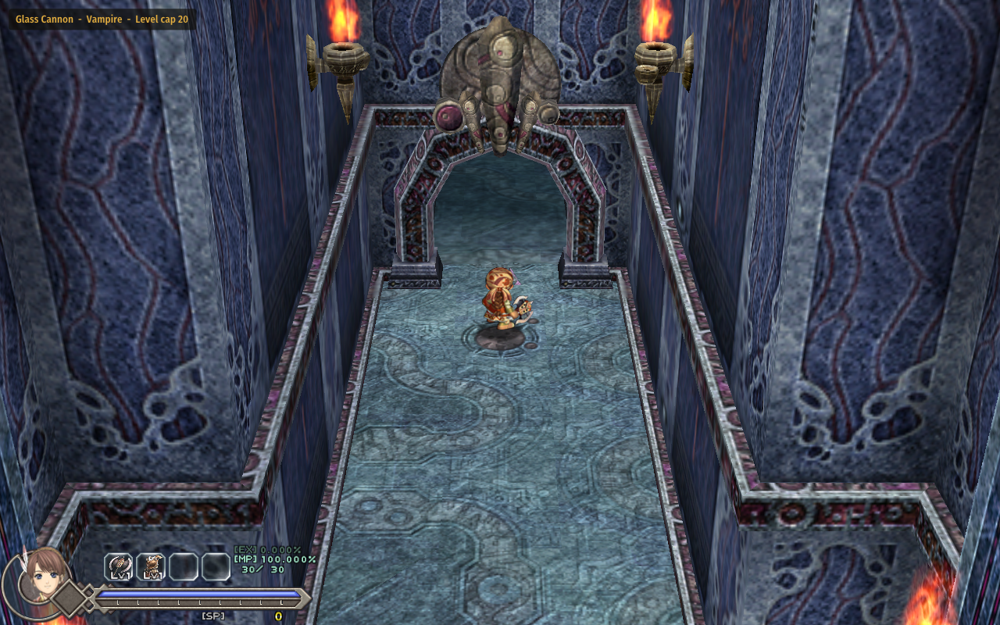

# Mutators

Challenge rules for **Ys Origin** on CleriaCore. Switch them on from **F1 > Mods > Mutators** and mix them freely.



| Rule | What it does |
|---|---|
| **Glass Cannon** | Your ATK is doubled and your max HP is halved |
| **Berserker** | The lower your HP, the harder you hit: up to twice your ATK at 1 HP |
| **One Hit** | Your max HP is 1 |
| **Vampire** | Recovery Drops heal nothing. Every kill heals 3% of your max HP instead |
| **Midas** | Everything a monster drops turns to gold, worth 5 SP per monster level |
| **Famine** | Monsters drop nothing at all |
| **Permadeath** | A death ends the run for good: a Retry or a reload of that game dies again |
| **Level cap** | You gain no EXP once you reach the level you chose (1 = a level 1 run) |

The rules apply at once, to any save, and are remembered between sessions. A line in the top-left corner lists
the active ones (it can be turned off).

## Install

1. Download `4rtefakt.mutators-1.0.0.cleriamod` from the [releases](../../releases).
2. Double-click it (or use F1 > Mods > *Install a mod file...*).
3. Turn **Mutators** on in F1 > Mods and restart CleriaCore.

Needs a CleriaCore with mod API 6.

## How it works

The whole mod is one Lua file, [main.lua](main.lua), about 150 lines. Each rule is a few lines over the mod API:

```lua
-- Vampire: Recovery Drops heal nothing, kills heal 3%
cleria.combat.add_filter("pickup", function(q)
    if on.Vampire and q.what == "hp" then return "suppress" end
end)
cleria.events.on("enemy_killed", function()
    if not on.Vampire then return end
    local hp, max = P.hp(), P.max_hp()
    if hp > 0 and hp < max then P.set_hp(math.min(max, hp + math.max(1, math.floor(max * 0.03 + 0.5)))) end
end)
```

| Rule | API |
|---|---|
| Glass Cannon, Berserker, One Hit | `cleria.player.set_modifier("atk" / "max_hp", add, mul)` |
| Level cap | the `"exp"` combat filter |
| Vampire | the `"pickup"` filter and the `enemy_killed` event |
| Midas, Famine | the `"drop"` filter (replace the item and give the pickup its own value, or suppress) |
| Permadeath | the `death` event, a run id in `cleria.save`, the dead runs in `cleria.data` |
| The page, the corner line | `cleria.ui.page`, `cleria.hud.layer`, `cleria.settings` |

## Tests

`python .dev/run.py` runs ten cases through CleriaCore's headless harness (a real engine, a real room, a real
monster): each rule is switched on, a monster is killed or the player is hurt, and the engine's own numbers are
checked. For example Midas: the level 3 monster's two drops become gold worth 15 SP each, and the wallet reads
4 + 30.

What that does not cover: nobody has played a whole run with these rules yet. Berserker and One Hit against
bosses, and Permadeath across a real save and reload from the title, are checked by reasoning and by the short
cases only.

## More CleriaCore mods

Each one is a small Lua mod that shows a different part of the mod API:

- [Solo Randomizer](https://github.com/4rtefakt/cleriacore-solo-randomizer): the tower's chests shuffled from a seed, always beatable, no server
- [Daily Challenge](https://github.com/4rtefakt/cleriacore-daily-challenge): the date shuffles the chests and picks two rules, the same for everyone
- [Roguelite Perks](https://github.com/4rtefakt/cleriacore-roguelite-perks): every boss beaten lets you choose one of three random perks
- [New Game+](https://github.com/4rtefakt/cleriacore-new-game-plus): start again with part of your level, SP and weapon against a harder tower
- [Level Sync](https://github.com/4rtefakt/cleriacore-level-sync): monsters fight as if they were near your level
- [Adaptive Difficulty](https://github.com/4rtefakt/cleriacore-adaptive-difficulty): enemies hit softer after each death, and return to normal as you progress
- [Achievements](https://github.com/4rtefakt/cleriacore-achievements): thirty achievements kept across all your saves
- [Run HUD](https://github.com/4rtefakt/cleriacore-run-hud): room and run time, kills, deaths, damage per second
- [Bestiary+](https://github.com/4rtefakt/cleriacore-bestiary): a per-save hunting log of every monster killed
- [Autosave+](https://github.com/4rtefakt/cleriacore-autosave): rolling autosaves on a timer, after bosses and in new zones
- [Debug Menu](https://github.com/4rtefakt/cleriacore-debug-menu): change level, SP, items, gear, skills, blessings, warps and flags
- [Crowd Control](https://github.com/4rtefakt/cleriacore-crowd-control): Twitch chat votes on what happens to you
- [LiveSplit Autosplitter](https://github.com/4rtefakt/cleriacore-livesplit): starts and splits LiveSplit over its WebSocket server
- [Archipelago](https://github.com/4rtefakt/ys-origin-cleriacore-ap): the multiworld randomizer client, the biggest one

## About

Written with AI assistance (Claude Code) as a showcase of the CleriaCore mod API, and tested as described above.
MIT license.
